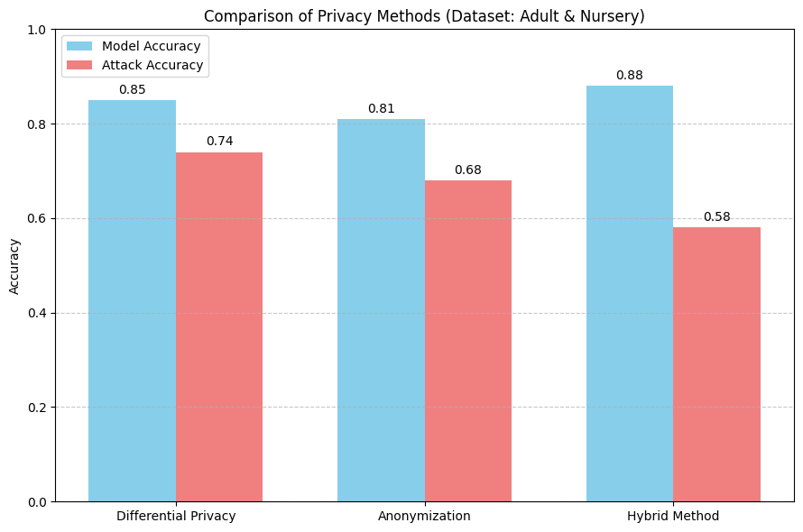
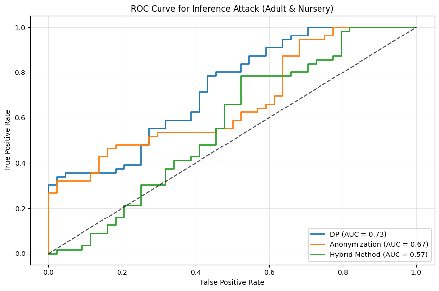

# Logical and Experimental Analysis: Hybrid Privacy-Preserving Method

This folder (**Logic_Experiment**) contains documentation, experimental evidence, and logical explanations supporting the effectiveness of our proposed **Hybrid Privacy-Preserving Method** compared to traditional approaches (**Differential Privacy** and **Anonymization**).

## Logic & Design Choices: Explicit Q&A Justification

### **Q1: Why perform an FRC (Feature Relevance Check)?**
Conducting an explicit Feature Relevance Check ensures that only genuinely necessary and meaningful data enters the ML pipeline. By proactively assessing relevance, we significantly reduce privacy risks, aligning explicitly with GDPR's data minimization principles and limiting potential exposure to adversarial attacks like attribute and membership inference.

### **Q2: How does feature selection before ML model training protect data according to GDPR?**
GDPR explicitly mandates data minimization—processing only data strictly necessary for a specified purpose. Selecting features before they reach the ML model explicitly ensures compliance by preventing unnecessary or redundant data exposure, thus reducing privacy risks and potential regulatory breaches.

### **Q3: Why do traditional methods like data minimization, generalization, or knowledge distillation still fail under GDPR guidelines?**
Traditional methods such as data minimization, generalization, or knowledge distillation reduce data granularity but still allow privacy leakage. For instance, categorizing age into brackets (e.g., 30-35 years) or generalizing salaries into ranges (€40,000 - €60,000) still permits adversaries to target or re-identify individuals. Our explicit feature relevance checks and proactive feature selection approach mitigate these risks by entirely removing unnecessary data, ensuring stronger GDPR compliance. This directly contradicts the research paper Goldsteen et al., 2022 in this project.

### **Q4: How do we decide which features to select, and why not rely solely on entropy-based approaches?**
Entropy-based methods, although common, are context-unaware. In real-world scenarios, such as loan approvals, key features like marital status or nationality may have low entropy yet remain critically important. Our hybrid approach explicitly leverages SHAP values (interpretable, model-driven importance) and Knowledge Graphs (contextual relationships) to ensure feature selection is both context-aware and practically relevant.

### **Q5: How does our method prevent data from being directly fed into ML models, and why is mere data minimization insufficient?**
Traditional data minimization or generalization reduces granularity only after data exposure. Our proactive approach explicitly filters out irrelevant data before it reaches the ML pipeline, preventing unnecessary exposure altogether. This significantly limits privacy risks, aligning with the data minimisation principles of the GDPR and the CCPA.

### **Q6: Why address both numerical and non-numerical features, unlike the cited research paper?**
Focusing solely on numerical data excludes substantial sensitive and categorical information essential in approximately 90% of real-world use cases. Our approach explicitly evaluates relevance using SHAP and Knowledge Graphs, ensuring comprehensive, practical privacy protections.

### **Q7: Why use PAC Privacy instead of Differential Privacy (DP)?**
PAC Privacy (Xiao & Devadas, 2023) bounds how well *any* adversary can recover sensitive data, and it can automatically compute the minimum noise needed for a chosen guarantee by simulating the data-processing pipeline. DP protects against a worst-case adversary and often needs more noise, which costs accuracy. That makes PAC Privacy an attractive target for this project. Note that the current notebooks do not yet implement PAC Privacy's noise calibration: they add hand-tuned noise and report an empirical bound on one attacker's accuracy (see `theoretical_foundations/`).

### **Q8: Why is PAC Privacy more admissible than Differential Privacy?**
Differential Privacy guarantees indistinguishability for any single record against any adversary, regardless of the data distribution, which is strong but often expensive in accuracy. PAC Privacy instead measures, for the actual data distribution, how hard it is to reconstruct sensitive data. It is weaker in the worst case but can give meaningful guarantees with much less noise. Which one is "more admissible" depends on the threat model and on what a regulator or auditor expects; DP remains the more established standard.

### **Q9: Why include Autoencoders in our approach?**
Autoencoders effectively compress data, capturing non-linear feature interactions and reducing redundancy. Combined with adversarial training, autoencoders explicitly limit the leakage of sensitive information. This embedding step further strengthens privacy without significantly impacting model accuracy.

### **Q10: Why choose Autoencoders over Homomorphic Encryption and Federated Learning?**
Homomorphic encryption protects data while it is being computed on, but it adds heavy computational cost and restricts which models can be used. Federated learning keeps raw data on users' devices, but it adds coordination and communication overhead, and model updates can still leak information. Both protect *how* data is processed; they do not reduce *what* data is used. Feature selection and autoencoders address that minimisation question directly, are cheap to run, and could be combined with either technique rather than replacing them.

## Experimental Context

We explored logical privacy-preserving strategies to mitigate two critical types of inference attacks:

- **Membership inference attacks:** determining if a data record was part of a training dataset.
- **Attribute inference attacks:** inferring sensitive attributes from partially observed data.

### Evaluated Methods:

- **Differential Privacy (DP)**: Noise-based protection.
- **Anonymization**: Generalization-based protection.
- **Hybrid Method (Our Proposed Approach)**: Proposes KG+SHAP+Autoencoders+PAC.

## Illustrative Comparison (not an experimental result)

> **Read this first.** The chart and ROC curves in this folder are **illustrations**, not measurements. The accuracy and attack values were typed in by hand from different notebooks and datasets (the DP figures come from Nursery, the anonymisation figures from Adult), the 88% hybrid accuracy does not match any notebook output (the Adult pipeline reaches about 81%), and the ROC curves are generated from synthetic random scores tuned to hit chosen AUC values. For measured results, see `proposed_method_implementation/` and the main README.

A proper version of this comparison would run DP, anonymisation and the hybrid method on the **same** dataset, with the same target model and the same attack protocol, and plot ROC curves from the attacks' real scores.

## Logical Insights & Implications

The design argument is that anonymisation reduces linkage but costs utility, DP protects membership but spreads noise across every feature, and selecting features first means less data needs protecting at all. That argument is reasonable; demonstrating it requires the like-for-like comparison described above.

## Reproducing Results

All experimental results and visualizations are documented within the Jupyter notebook (`hybrid_privacy_inference_analysis.ipynb`) in this folder, including the hand-entered values behind the illustrative chart and the synthetic-score ROC construction.

---

For further inquiries or replication guidance, please review the notebook or reach out directly.
